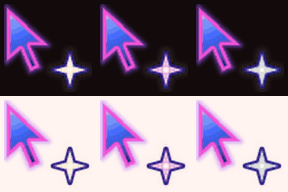

# kopi-kopi

Copy and paste with taps instead of keyboard shortcuts.
Made for copying long terminal logs into Claude Code without wrestling with your trackpad.



```
three-finger tap  →  cursor turns blue
tap start         →  scroll as far as you like  →  tap end      (copied)
   …or just drag over the text                                  (copied)
three-finger tap  →  pasted where your pointer is, cursor back to normal
```

Three-finger tap again before copying cancels.

The cursor turns into a small galaxy, and a revolving star tells you where you are:
**yellow** = ready, **pink** = start placed, **green** = copied, tap to paste.
If nothing was selected you go back to yellow, and the old clipboard is never pasted.
The star colours come from my HIKARI design system.
Everything goes through the normal clipboard, so **Win+V** clipboard history keeps working.

## Setup (Windows)

1. **Make three-finger tap a middle click:**
   Settings → Bluetooth & devices → Touchpad → Three-finger gestures → Taps → **Middle mouse button**.
   (On a mouse, the wheel click already is one.)
2. Install and run (Python 3.9+):
   ```
   pip install -r requirements.txt
   python -m kopi_kopi
   ```
3. Quit with Ctrl+C in that window. Add `--debug` to print every click it sees.
   If the cursor ever stays blue: `python -m kopi_kopi --reset-cursor`.

macOS and Linux: coming next. The core logic is already OS-independent.

## How it works

| File | Job |
|---|---|
| `kopi_kopi/core.py` | The state machine: OFF → ARMED → HAS_START → COPIED → OFF. Pure logic, unit tested. |
| `kopi_kopi/platforms/windows.py` | Low-level mouse hook, blue system cursor, clipboard change counter. |
| `kopi_kopi/app.py` | Glue: hook thread decides instantly, worker thread does the slow work. |
| `kopi_kopi/cursor_art.py` | Draws the cursors with signed distances (smooth edges, any size) and packs the animation into `.ani` files. |
| `kopi_kopi/config.py` | HIKARI colours, cursor size, drag threshold and a few other knobs. |
| `tools/preview.py` | Renders the cursors as a GIF (needs Pillow; not needed to run kopi-kopi). |

Ideas behind it:

- **Selecting long ranges uses Shift+Click**, which almost every app supports: click the start, Shift+Click the end.
  kopi-kopi lets your start tap through untouched, then *swallows* your end tap and replays it with Shift held.
- **The trigger is always swallowed**, so apps never see a stray middle click.
- **Drags aren't touched at all.** The app selects as usual, and kopi-kopi copies when you let go.
  If the app already copied on its own (Claude Code does), kopi-kopi skips Ctrl+C, because in a terminal
  Ctrl+C with nothing selected means "stop the program".
- **The animation costs nothing.** The cursors are animated `.ani` files, so Windows plays the frames
  itself. kopi-kopi draws them once (cached on disk) and does no work per frame, so your clicks
  are never slowed down.
- **Copies are verified.** Windows counts every clipboard change; if the count didn't move after Ctrl+C,
  nothing was copied, so kopi-kopi lets you retry instead of pasting whatever was there before.
- **Our own synthetic clicks are ignored** by the hook: kopi-kopi stamps them with a tag ("KOPI") and skips
  tagged events. Windows' generic "injected" flag isn't enough, because touchpad drivers inject events too,
  including the three-finger-tap middle click.

## Tests

```
pip install pytest
python -m pytest
```

## Roadmap

- v0.2: macOS and Linux backends, tray icon, start with Windows
- v1.x: double three-finger tap opens a kopi-kopi clipboard history
